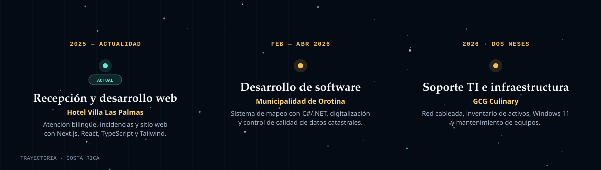
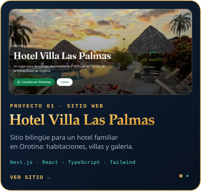
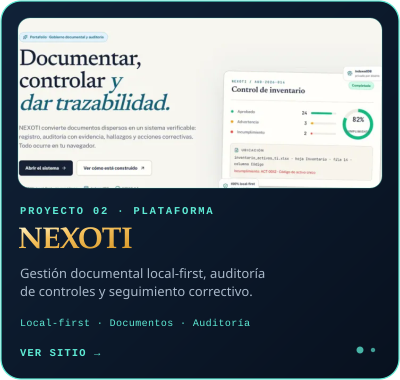
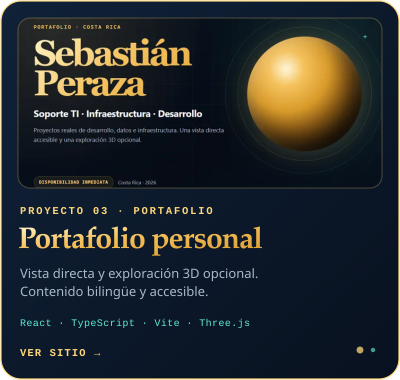

  <picture>
    <source media="(max-width: 700px) and (prefers-reduced-motion: reduce)" srcset="assets/hero-mobile-still.svg">
    <source media="(max-width: 700px)" srcset="assets/hero-mobile-motion.svg">
    <source media="(prefers-reduced-motion: reduce)" srcset="assets/hero-still.svg">
    
  </picture>

  

    
    
    
  

## Hola, soy Sebastián

> **Tecnología que resuelve. Atención que acompaña.**

Detrás de cada falla hay una persona esperando: con prisa, con dudas, con un día complicado. Mi trabajo es que esa persona vuelva a respirar tranquila.

Soy Bachiller en Ingeniería en Tecnologías de la Información por la Universidad Técnica Nacional, Costa Rica. Me muevo entre la infraestructura que sostiene el trabajo diario y el software que lo hace más simple: soporte técnico, redes, desarrollo y datos.

He documentado y reorganizado puntos de red, llevado inventario de activos TI, dado soporte a equipos y usuarios, participado en migración y control de calidad de datos catastrales, y desarrollado y administrado el sitio web bilingüe de un hotel.

**Convierto problemas en tranquilidad.**

### Cómo trabajo

- **Escucho primero.** Entiendo el problema y a la persona que lo vive.
- **Resuelvo con claridad.** Soluciones simples, explicadas y documentadas.
- **Acompaño hasta el final.** Confirmo que funciona y sigo disponible.

## Trayectoria

<picture>
  <source media="(max-width: 700px)" srcset="assets/timeline-mobile.svg">
  
</picture>

## Dónde puedo aportar

| Área | Aporte |
|---|---|
| **Soporte TI e infraestructura** | Hardware, Windows 11, mantenimiento, inventario, documentación y atención de incidencias. |
| **Redes** | Cableado estructurado, identificación y documentación de puntos de red, conectividad y formación Cisco Networking Academy. |
| **Desarrollo** | Sitios y aplicaciones web con Next.js, React, TypeScript y Tailwind CSS; C#/.NET y Java. |
| **Datos** | SQL, migración, validación, control de calidad y análisis de información. |

<picture>
  <source media="(max-width: 700px) and (prefers-reduced-motion: reduce)" srcset="assets/astronaut-guide-mobile-still.svg">
  <source media="(max-width: 700px)" srcset="assets/astronaut-guide-mobile.svg">
  <source media="(prefers-reduced-motion: reduce)" srcset="assets/astronaut-guide-still.svg">
  
</picture>

## Tech Universe

<picture>
  <source media="(max-width: 700px)" srcset="assets/tech-universe-mobile.svg">
  <source media="(prefers-reduced-motion: reduce)" srcset="assets/tech-universe-still.svg">
  
</picture>

<strong>Ver stack completo</strong>

**Desarrollo**  
TypeScript · JavaScript · React · Next.js · Tailwind CSS · C#/.NET · Java · Python · REST APIs

**Datos**  
SQL · SQL Server · MySQL · PostgreSQL · MongoDB · Firebase · Power BI · R · Excel

**Infraestructura y redes**  
Windows 11 · Linux · Cisco · VLANs · OSPFv2 · ACLs · NAT · WLAN/WLC · Docker · AWS · Git/GitHub

## Proyectos destacados

También diseño y administro sitios web para negocios. **Tu próximo cliente podría estar a un clic de distancia.**

  
  
  

## Actividad

<picture>
  <source media="(max-width: 700px) and (prefers-reduced-motion: reduce)" srcset="assets/activity-constellation-mobile-still.svg">
  <source media="(prefers-reduced-motion: reduce)" srcset="assets/activity-constellation-still.svg">
  <source media="(prefers-color-scheme: dark)" srcset="https://raw.githubusercontent.com/Sebasprzd/Sebasprzd/output/activity-snake-dark.svg">
  
</picture>

[Ver actividad completa en GitHub](https://github.com/Sebasprzd) · [Repositorios públicos](https://github.com/Sebasprzd?tab=repositories)

## Contacto

- **Portafolio:** [sebastian-peraza.netlify.app](https://sebastian-peraza.netlify.app)
- **LinkedIn:** [linkedin.com/in/sebasprzd](https://www.linkedin.com/in/sebasprzd/)
- **GitHub:** [github.com/Sebasprzd](https://github.com/Sebasprzd)
- **Correo:** [speraza.desa17@gmail.com](mailto:speraza.desa17@gmail.com)
- **Ubicación:** Orotina, Alajuela, Costa Rica
- **Idiomas:** Español nativo · English B2
- **Disponibilidad:** inmediata · trabajo remoto

<strong>English</strong>

**Technology that solves. Care that stays.** I turn problems into peace of mind.

I hold a Bachelor's degree in Information Technology Engineering from Universidad Técnica Nacional, Costa Rica. I work between the infrastructure that keeps daily work running and the software that makes it simpler: IT support, networking, development and data.

I am open to opportunities in IT support, networking, software development and data. [Portfolio](https://sebastian-peraza.netlify.app) · [LinkedIn](https://www.linkedin.com/in/sebasprzd/)

<picture>
  <source media="(prefers-reduced-motion: reduce)" srcset="assets/footer-still.svg">
  
</picture>
