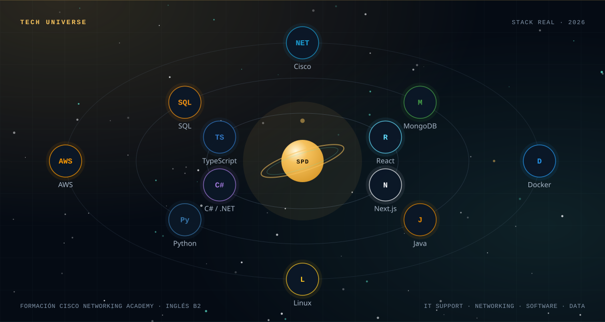
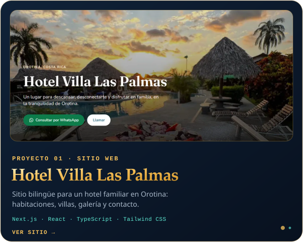
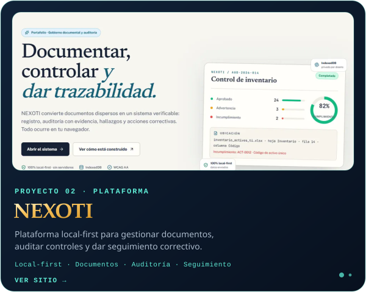

  <picture>
    <source media="(max-width: 700px) and (prefers-reduced-motion: reduce)" srcset="assets/hero-mobile-still.svg">
    <source media="(max-width: 700px)" srcset="assets/hero-mobile-motion.svg">
    <source media="(prefers-reduced-motion: reduce)" srcset="assets/hero-still.svg">
    
  </picture>

## Hola, soy Sebastián 👋

Bachiller en Ingeniería en Tecnologías de la Información por la Universidad Técnica Nacional, Costa Rica. Me muevo entre la infraestructura que sostiene el trabajo diario y el software que lo hace más simple.

Mi experiencia práctica combina soporte técnico, redes, desarrollo y datos. He documentado y reorganizado puntos de red, llevado inventario de activos TI, dado soporte a equipos y usuarios, participado en migración y control de calidad de datos catastrales, y desarrollado y administrado el sitio web bilingüe de un hotel.

Me caracterizan la curiosidad, la atención al detalle y una comunicación cercana. Disfruto entender un problema, encontrar una solución útil y explicarla con claridad.

> **Tecnología que resuelve. Atención que acompaña.**
>
> Me importa que la solución funcione y que la persona que la usa se sienta acompañada.

**Actualmente** trabajo en Hotel Villa Las Palmas y estoy abierto a oportunidades en soporte TI, infraestructura, redes, desarrollo de software y datos.

### Trayectoria

- **GCG Culinary** — Soporte TI e infraestructura (práctica, 2026): red cableada, inventario de activos, Windows 11 y mantenimiento de equipos.
- **Municipalidad de Orotina** — Desarrollo de software (práctica, 2026): C#/.NET, digitalización y control de calidad de datos catastrales.
- **Hotel Villa Las Palmas** — Recepción y desarrollo web (2025 – actualidad): atención bilingüe y sitio web con Next.js, React, TypeScript y Tailwind CSS.

## Dónde puedo aportar

| Área | Aporte |
|---|---|
| **Soporte TI e infraestructura** | Hardware, Windows 11, mantenimiento, inventario, documentación y atención de incidencias. |
| **Redes** | Cableado estructurado, identificación y documentación de puntos de red, conectividad y formación Cisco Networking Academy. |
| **Desarrollo** | Sitios y aplicaciones web con Next.js, React, TypeScript y Tailwind CSS; C#/.NET y Java. |
| **Datos** | SQL, migración, validación, control de calidad y análisis de información. |

<picture>
  <source media="(max-width: 700px) and (prefers-reduced-motion: reduce)" srcset="assets/astronaut-guide-mobile-still.svg">
  <source media="(max-width: 700px)" srcset="assets/astronaut-guide-mobile.svg">
  <source media="(prefers-reduced-motion: reduce)" srcset="assets/astronaut-guide-still.svg">
  
</picture>

## Tech Universe

<picture>
  <source media="(max-width: 700px)" srcset="assets/tech-universe-mobile.svg">
  
</picture>

<strong>Ver stack completo</strong>

**Desarrollo**  
TypeScript · JavaScript · React · Next.js · Tailwind CSS · C#/.NET · Java · Python · REST APIs

**Datos**  
SQL · SQL Server · MySQL · PostgreSQL · MongoDB · Firebase · Power BI · R · Excel

**Infraestructura y redes**  
Windows 11 · Linux · Cisco · VLANs · OSPFv2 · ACLs · NAT · WLAN/WLC · Docker · AWS · Git/GitHub

## Proyectos destacados

  
  

**Hotel Villa Las Palmas** — Sitio informativo bilingüe para un hotel familiar en Orotina: habitaciones, villas, pase del día, galería, mapa, WhatsApp y privacidad.  
`Next.js` `React` `TypeScript` `Tailwind CSS`  
[Visitar sitio](https://hotel-villa-las-palmas-orotina.netlify.app)

**NEXOTI** — Plataforma local-first de gestión documental, auditoría de controles y seguimiento correctivo; los archivos se procesan en el navegador.  
[Visitar sitio](https://nexoti-cr.netlify.app)

**Portafolio personal** — Vista directa completa y exploración 3D opcional, con contenido bilingüe y foco en accesibilidad y rendimiento.  
`React` `TypeScript` `Vite` `Three.js`  
[Visitar sitio](https://sebastian-peraza.netlify.app)

## Constelación de contribuciones

<picture>
  <source media="(max-width: 700px) and (prefers-reduced-motion: reduce)" srcset="assets/activity-constellation-mobile-still.svg">
  <source media="(max-width: 700px)" srcset="assets/activity-constellation-mobile-motion.svg">
  <source media="(prefers-reduced-motion: reduce)" srcset="assets/activity-constellation-still.svg">
  
</picture>

**12 contribuciones · 4 días activos · últimos 12 meses.**  
[Ver actividad completa en GitHub](https://github.com/Sebasprzd) · [Repositorios públicos](https://github.com/Sebasprzd?tab=repositories)

*Snapshot de actividad pública. El gráfico nativo de GitHub sigue disponible en el perfil.*

## Contacto

- **Portafolio:** [sebastian-peraza.netlify.app](https://sebastian-peraza.netlify.app)
- **LinkedIn:** [linkedin.com/in/sebasprzd](https://www.linkedin.com/in/sebasprzd/)
- **GitHub:** [github.com/Sebasprzd](https://github.com/Sebasprzd)
- **Correo:** [speraza.desa17@gmail.com](mailto:speraza.desa17@gmail.com)
- **Ubicación:** Orotina, Alajuela, Costa Rica
- **Idiomas:** Español nativo · English B2
- **Disponibilidad:** inmediata

*Open to opportunities in IT support, networking, software development and data.*

<picture>
  <source media="(prefers-reduced-motion: reduce)" srcset="assets/footer-still.svg">
  
</picture>
